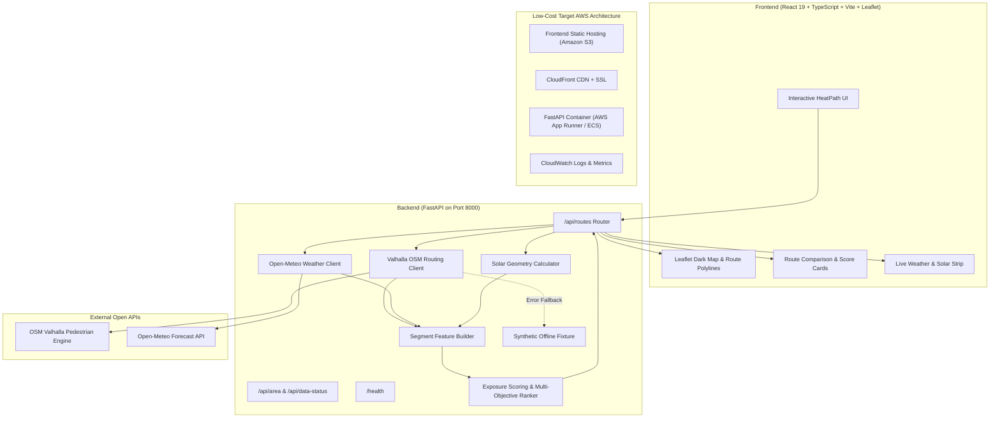

# HeatPath — Personalized Heat-Exposure Routing for Indian Cities

> **WeMakeDevs Environmental Hacks | Track 02: Heat & Water**  
> *Tagline:* Choose a practical walking route with lower estimated heat exposure.

---

## 1. Problem & User Value

In Indian cities during summer and dry seasons, walking even short distances can lead to acute heat exhaustion. Standard navigation systems (Google Maps, Apple Maps) optimize exclusively for distance or walking duration. A route that saves two minutes may force a pedestrian directly through unshaded arterial roads under scorching midday sun, when a slightly longer alternative along quieter streets would significantly lower solar exposure.

**HeatPath** solves this by providing:
- Side-by-side pedestrian route comparison (distance, duration, and relative heat-exposure proxy).
- Multi-objective preference controls: **Faster**, **Balanced**, and **Lower estimated exposure**.
- Dynamic time-of-day solar calculations (solar elevation, azimuth, irradiance proxy).
- Honest, explainable trade-offs without black-box claims or pseudo-medical advice.
- Pilot implementation for **Pune, Maharashtra, India** (Shivajinagar & Deccan Gymkhana).

---

## 2. Features Actually Implemented

- [x] **Pedestrian Alternative Routing:** Live integration with OpenStreetMap / Valhalla routing engine for multi-alternative pedestrian paths.
- [x] **Live Weather Integration:** Real-time retrieval of temperature, apparent temperature, UV index, and cloud cover from Open-Meteo.
- [x] **Time-Aware Solar Position Engine:** Deterministic calculation of solar elevation angle and clear-sky solar irradiance proxy based on departure timestamp and coordinates.
- [x] **Explainable Exposure Model:** Segment-level heuristic scoring clamped in $[0, 1]$ and duration-weighted route aggregation.
- [x] **Multi-Objective Cost Ranking:** User-selectable optimization profiles (`faster`, `balanced`, `exposure`) balancing walk time against estimated heat cost.
- [x] **Data Transparency & Confidence Badges:** Direct labelling of data provenance (`live`, `cached`, `sample`) and confidence indicators (`high`, `medium`, `low`).
- [x] **Interactive Leaflet Map:** Dark-mode geospatial map view with color-coded route polylines and turn-by-turn route selection.
- [x] **Deterministic Offline Fallback:** Clearly labelled demo fixture ensuring offline reliability without misrepresenting sample data as live observations.
- [x] **Full Automated Test Suite:** 37 passing unit & integration tests covering solar geometry, normalization, clamping, edge cases, and API contracts.

---

## 3. Architecture



---

## 4. Tech Stack

- **Frontend:** React 19, TypeScript, Vite, Leaflet, React-Leaflet, Vanilla CSS design system.
- **Backend:** Python 3.14+, FastAPI, Pydantic v2, Uvicorn, HTTPX.
- **Testing:** Pytest, Pytest-Asyncio, Pytest-HTTPX (37 tests).
- **Geospatial & Solar:** Custom spherical astronomy engine, Valhalla pedestrian routing client, OpenStreetMap.
- **Weather:** Open-Meteo forecast API (hourly & current conditions).

---

## 5. Local Setup Instructions (Ubuntu / Linux)

### Prerequisites
- Python 3.11+ (Python 3.14 tested and verified)
- Node.js 18+ & npm 9+
- Git, curl

### Backend Setup
```bash
# Navigate to backend directory
cd heatpath/backend

# Create virtual environment and activate
python3 -m venv .venv
source .venv/bin/activate

# Install backend dependencies
pip install -r requirements.txt

# Run test suite
pytest tests/ -v

# Start FastAPI server
uvicorn app.main:app --host 127.0.0.1 --port 8000
```
Backend will be live at `http://127.0.0.1:8000` with interactive Swagger docs at `http://127.0.0.1:8000/docs`.

### Frontend Setup
```bash
# In a new terminal, navigate to frontend directory
cd heatpath/frontend

# Install frontend dependencies
npm install

# Run type check and build
npm run build

# Start Vite dev server
npm run dev -- --host 127.0.0.1 --port 5173
```
Frontend will be live at `http://127.0.0.1:5173`.

---

## 6. Environment Configuration

Copy `.env.example` to `.env` in `backend/`:
```bash
cp heatpath/.env.example heatpath/backend/.env
```

Key environment variables:
```ini
BACKEND_HOST=0.0.0.0
BACKEND_PORT=8000
CORS_ORIGINS=http://localhost:5173,http://localhost:4173
VALHALLA_BASE_URL=https://valhalla1.openstreetmap.de
OPEN_METEO_BASE_URL=https://api.open-meteo.com/v1
PILOT_LAT_MIN=18.490
PILOT_LAT_MAX=18.545
PILOT_LON_MIN=73.820
PILOT_LON_MAX=73.880
PILOT_CENTER_LAT=18.5204
PILOT_CENTER_LON=73.8567
PILOT_TIMEZONE=Asia/Kolkata
```

---

## 7. Data Sources & Attribution

See [DATA_SOURCES.md](file:///home/elliot/Downloads/Wemakedevs/heatpath/DATA_SOURCES.md) for full licensing, field definitions, and access dates.
- **OpenStreetMap:** © OpenStreetMap contributors (ODbL 1.0). Pedestrian way geometries and routing via Valhalla (MIT).
- **Open-Meteo:** Weather data from Open-Meteo.com (CC BY 4.0).
- **Solar Calculations:** Built-in Spencer/astronomical spherical formulas (Public Domain / MIT).

---

## 8. Exposure Model & Score Interpretation

### Segment Exposure Formula
$$
S_i = \text{clamp}\left( 0.40 \cdot f_{\text{sun}} + 0.35 \cdot f_{\text{uv}} + 0.25 \cdot f_{\text{weather}}, 0, 1 \right)
$$
Where:
- $f_{\text{sun}} = \max(0, \sin(\theta_{\text{solar elevation}}))$
- $f_{\text{uv}} = \min(1.0, \text{UV Index} / 11.0)$
- $f_{\text{weather}} = \text{clamp}((\text{ApparentTemp} - 20) / 25, 0, 1) \cdot (1 - 0.5 \cdot \text{CloudCover})$

### Multi-Objective Route Cost
$$
\text{Cost} = \alpha \cdot \text{NormTime} + \beta \cdot \text{AvgExposure} + \gamma \cdot \text{NormDistance}
$$

### Important Clarifications
- Scores are **estimated relative exposure proxies**, NOT measured temperatures or medical advice.
- The UI displays **"estimated model score reduction"**, NEVER "X% less heat experienced".

---

## 9. API Endpoints

- `GET /health`: Health check and app version.
- `GET /api/area`: Pilot bounding box, center coordinates, and quick test locations.
- `GET /api/data-status`: Current provenance status of routing, weather, and solar calculation services.
- `POST /api/routes`: Accepts origin, destination, ISO 8601 departure time, and profile. Returns scored candidate routes with GeoJSON geometries, metrics, and structured explanations.

---

## 10. AWS Integration Status

- **Status:** Architecture planned for low-cost AWS deployment; local verified implementation active.
- **Intended AWS Infrastructure:**
  - **Amazon S3:** Static hosting for Vite production bundle.
  - **Amazon CloudFront:** SSL edge delivery and routing caching.
  - **AWS App Runner / ECS Fargate:** Running containerized FastAPI backend.
  - **Amazon CloudWatch:** API latency and error logging.
- In compliance with Non-Negotiable Rule 10, no paid cloud resources were spun up automatically without explicit user sign-off.

---

## 11. Testing & Verification

- **Backend tests:** 37 passed (`pytest backend/tests/ -v`).
- **Frontend build:** Clean production build with zero TypeScript errors (`tsc -b && vite build`).
- **Real-time verification:** Live routing and live weather requests executed and validated against Pune test coordinates.

---

## 12. Known Limitations & Future Work

1. **Building Heights & Shadow Geometry:** Pune does not currently have open LIDAR or comprehensive 3D building height tags in OSM. Exact shadow polygons cannot be computed without building heights.
2. **Street Tree Canopy:** Tree canopy is not uniformly mapped across all Pune lanes in OSM. The model omits this feature rather than hallucinating vegetation.
3. **Pilot Bounding Box:** Currently bounded to Central Pune (Shivajinagar & Deccan Gymkhana).

---

## 13. Project Links & Submission Placeholders

- **GitHub Repository:** *[User to insert public repository link]*
- **Live Deployment:** *[User to insert deployed URL if AWS deployed]*
- **Demo Video (Under 3 mins):** *[User to insert YouTube link]*
- **Hackathon Track:** WeMakeDevs Environmental Hacks — Track 02: Heat & Water

---

## 14. License

This project is licensed under the MIT License — see the LICENSE file for details.  
OpenStreetMap data is subject to the Open Database License (ODbL). Weather data is subject to CC BY 4.0 (Open-Meteo).
