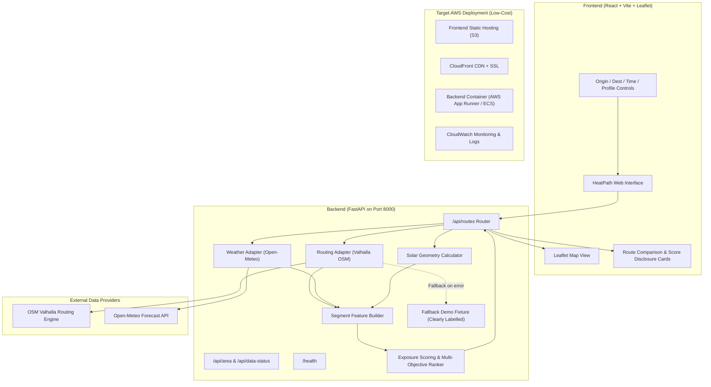

# HeatPath — Architecture and System Design

**Document:** `docs/ARCHITECTURE.md`  
**Status:** MVP Implemented and Verified  
**Stack:** React 19 + TypeScript + Vite + Leaflet (Frontend) | FastAPI + Python 3.14 + Pydantic v2 (Backend)  

---

## 1. System Architecture Diagram



---

## 2. Component Directory Structure

```
heatpath/
├── backend/
│   ├── app/
│   │   ├── api/routes.py          # FastAPI route endpoints
│   │   ├── config.py              # Environment configuration
│   │   ├── data_sources/weather.py# Open-Meteo HTTP adapter
│   │   ├── geospatial/features.py # Route segment decomposition
│   │   ├── main.py                # Application entry point & CORS
│   │   ├── routing/
│   │   │   ├── ranker.py          # Multi-objective route ranker
│   │   │   └── valhalla.py        # Valhalla pedestrian routing client
│   │   ├── schemas/routes.py      # Pydantic v2 validation models
│   │   ├── scoring/model.py       # Heuristic exposure scoring model
│   │   └── solar/calculator.py    # Astronomical solar position calculation
│   ├── tests/
│   │   ├── test_api.py            # API smoke & validation tests (5 tests)
│   │   └── test_scoring.py        # Model, normalization & solar tests (32 tests)
│   ├── requirements.txt
│   └── pytest.ini
├── frontend/
│   ├── src/
│   │   ├── components/
│   │   │   ├── HeatMap.tsx        # Leaflet interactive map & route polylines
│   │   │   └── RouteCard.tsx      # Route comparison cards & weather strip
│   │   ├── services/api.ts        # Typed fetch client
│   │   ├── App.tsx                # Main state & control interface
│   │   ├── index.css              # Dark mode design system & tokens
│   │   └── main.tsx
│   ├── index.html
│   ├── package.json
│   └── vite.config.ts
├── data/sample/pune_demo_routes.py# Deterministic offline fallback fixture
├── docs/
│   ├── IMPLEMENTATION_PLAN.md
│   ├── DATA_FEASIBILITY.md
│   ├── MODEL.md
│   ├── ARCHITECTURE.md
│   └── VALIDATION.md
├── DATA_SOURCES.md
├── README.md
├── .env.example
└── .gitignore
```

---

## 3. Data Flow

1. **User Input:** User chooses origin, destination, departure time, and preference profile.
2. **Pedestrian Routing:** Backend queries Valhalla pedestrian routing engine for up to 3 candidate walking paths.
3. **Macro Weather:** Backend queries Open-Meteo for the pilot bounding box at the departure time (temperature, apparent temperature, UV index, cloud cover).
4. **Solar Angle Calculation:** For the exact coordinates and departure timestamp, solar elevation and azimuth are calculated using spherical trigonometry.
5. **Segment Feature Construction:** Each route geometry is parsed into steps/segments. Feature vectors $[f_{\text{sun}}, f_{\text{uv}}, f_{\text{weather}}]$ are computed.
6. **Heuristic Scoring:** Segments are scored in $[0, 1]$. The duration-weighted average is calculated.
7. **Objective Ranking:** Multi-objective cost is evaluated and routes are sorted.
8. **Explainable Response:** The API returns candidate geometries, metrics, extra minutes vs fastest route, score reduction percentage (if applicable), and human-readable explanations.

---

## 4. Honest AWS Integration Status

- **Status:** Architecture designed for low-cost AWS deployment. Local implementation verified end-to-end.
- **Planned Services:**
  - **Amazon S3:** Hosting static Vite frontend assets.
  - **Amazon CloudFront:** SSL termination and global CDN edge distribution.
  - **AWS App Runner / ECS Fargate:** Running backend FastAPI container with automated health checks.
  - **Amazon CloudWatch:** Logging and error monitoring.
- **Cost Policy:** In strict adherence to Non-Negotiable Rule 10, no paid cloud resources were provisioned without explicit user approval. Step-by-step AWS deployment commands are provided in the README for evaluation.
